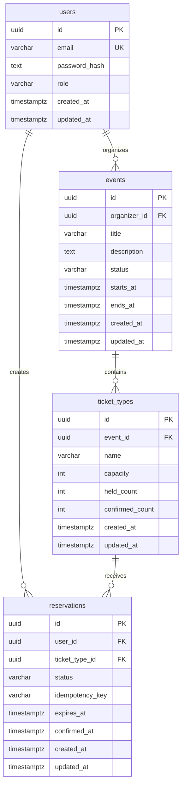
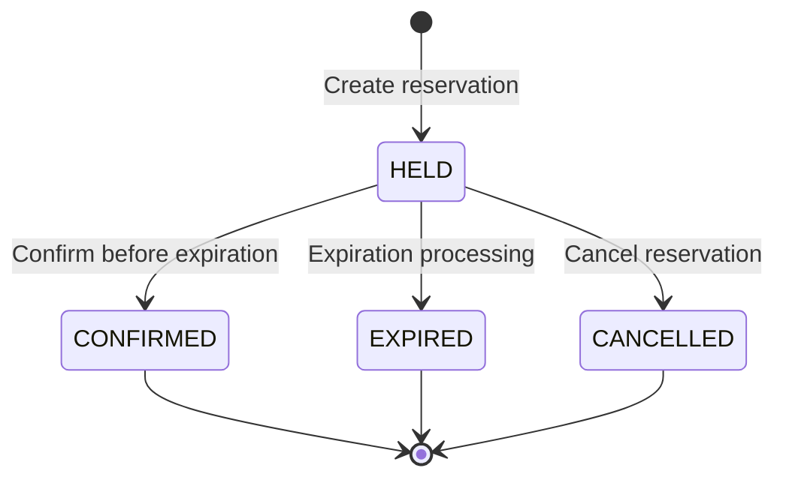

# FairSlot – Database Entity Relationship Diagram

## 1. Overview

FairSlot is a high-concurrency booking engine designed to
manage event reservations while preventing overselling.

The database uses PostgreSQL 17.

The initial schema consists of four entities:

- users
- events
- ticket_types
- reservations

The design prioritizes data consistency, referential
integrity, idempotency, and concurrency safety.

## 2. Entity Relationship Diagram

## 3. Entity Relationships

### 3.1 Users – Events

Relationship: One-to-Many (1:N)

- One user can organize multiple events.
- Each event belongs to exactly one organizer.

Foreign key:

`events.organizer_id -> users.id`

### 3.2 Users – Reservations

Relationship: One-to-Many (1:N)

- One user can create multiple reservations.
- Each reservation belongs to exactly one user.

Foreign key:

`reservations.user_id -> users.id`

### 3.3 Events – Ticket Types

Relationship: One-to-Many (1:N)

- One event can contain multiple ticket types.
- Each ticket type belongs to exactly one event.

Foreign key:

`ticket_types.event_id -> events.id`

### 3.4 Ticket Types – Reservations

Relationship: One-to-Many (1:N)

- One ticket type can have multiple reservations.
- Each reservation belongs to exactly one ticket type.
- Each reservation represents one ticket.

Foreign key:

`reservations.ticket_type_id -> ticket_types.id`

## 4. Reservation State Machine

### Reservation States

| Status | Description |
|---|---|
| HELD | Temporarily occupies one ticket |
| CONFIRMED | Successfully confirmed reservation |
| EXPIRED | Holding period has expired and inventory was released |
| CANCELLED | Reservation was cancelled and inventory was released |

In the MVP, CONFIRMED, EXPIRED, and CANCELLED are
terminal states.

A HELD reservation can only be confirmed before
its expiration time.

## 5. Database Constraints

### Users

- PRIMARY KEY (id)
- UNIQUE (email)
- CHECK role IN ('USER', 'ORGANIZER', 'ADMIN')
- Email must be stored in normalized lowercase form.

### Events

- PRIMARY KEY (id)
- FOREIGN KEY (organizer_id) REFERENCES users(id)
- CHECK status IN ('DRAFT', 'PUBLISHED', 'CANCELLED')
- CHECK (ends_at > starts_at)

### Ticket Types

- PRIMARY KEY (id)
- FOREIGN KEY (event_id) REFERENCES events(id)
- CHECK (capacity > 0)
- CHECK (held_count >= 0)
- CHECK (confirmed_count >= 0)
- CHECK (held_count + confirmed_count <= capacity)
- Case-insensitive unique ticket type name per event.

### Reservations

- PRIMARY KEY (id)
- FOREIGN KEY (user_id) REFERENCES users(id)
- FOREIGN KEY (ticket_type_id) REFERENCES ticket_types(id)
- CHECK status IN ('HELD', 'CONFIRMED', 'EXPIRED', 'CANCELLED')
- UNIQUE (user_id, idempotency_key)
- CHECK (expires_at > created_at)
- confirmed_at must be non-null if and only if status is CONFIRMED.

A partial unique index will enforce at most one
HELD or CONFIRMED reservation per user and ticket type.

## 6. Inventory Model

Ticket inventory is maintained using:

- capacity
- held_count
- confirmed_count

Available capacity:

`available = capacity - held_count - confirmed_count`

Required invariant:

`held_count + confirmed_count <= capacity`

Important:

held_count represents reservations whose database
status is HELD, including reservations whose expiration
time has passed but have not yet been processed.

Capacity is released only when a reservation is
atomically transitioned from HELD to EXPIRED or CANCELLED.

The database transaction must update both reservation
state and inventory counters.

## 7. Design Notes

- PostgreSQL is the source of truth.
- Primary keys use UUID.
- Timestamps use TIMESTAMPTZ.
- Foreign keys use restrictive deletion behavior.
- Reservation records are retained for history.
- Inventory counters require transactional updates.
- CHECK constraints cannot enforce cross-table counter consistency.
- Idempotency prevents duplicate committed booking operations.
- Partial unique indexes prevent duplicate active reservations.

See [Database Design](./database-design.md)
for the complete technical specification.
